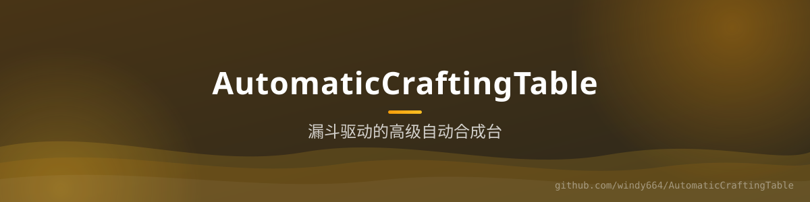

<div align="center">



# AutomaticCraftingTable

**漏斗驱动的高级自动合成台** —— 把合成台放进漏斗系统即可持续自动合成；潜行左键打开配置界面，支持数量限额与 SQLite 持久化。


[功能](#-功能) · [命令](#-命令) · [配置](#️-配置)

</div>

## ✨ 功能

- **漏斗自动化**：在高级自动合成台上方放置漏斗即可激活，按配方持续输出产物
- **配置界面**：对着合成台 `Shift + 左键` 打开 UI，可视化设置配方（`CraftingTableEditUI`）
- **数量限额**：每名玩家的合成台数量上限可配（`default-maximum-limit`），管理员可用 `/act` 调整
- **反馈与隔离**：合成进度可视化/音效反馈可开关；`separate-from-other-crafting-tables` 控制与原版合成台隔离
- **持久化**：合成台与配方数据存 SQLite（`SQLiteUtil`），重启不丢

> 基于Phil 的 AutomaticCraftingTable 改造：新增数量限额、岛屿数值管理命令与中文本地化。

## 📜 命令

| 命令 | 说明 | 权限 |
|------|------|------|
| `/getACT` | 获取一个高级自动合成台 | 所有人 |
| `/act <玩家> <数值>` | 调整玩家的合成台数量限额 | `act.change`（OP） |

## ⚙️ 配置

```yaml
enabled: true
crafting-table-ui-display: '⚙️ 高级自动合成台'
crafting-table-timer: 4              # 合成节拍
crafting-table-visual-feedback-enabled: true
crafting-table-sound-feedback-enabled: true
default-maximum-limit: 3             # 默认每人可放置数量
```

## 🔨 构建

```bash
./gradlew build
```
